<p align="center">
  
</p>

<h1 align="center">ForensiX Hash</h1>

<p align="center">
  <b>Hashes forenses verificados de archivos, carpetas y discos, con informe PDF como comprobante.</b><br>
  App de escritorio para Windows · web local · línea de comandos
</p>

<p align="center">
  <a href="https://github.com/ZaperMaster/ForensiX-Hash/actions/workflows/tests.yml"></a>
  <a href="https://github.com/ZaperMaster/ForensiX-Hash/security/code-scanning"></a>
  <a href="https://github.com/ZaperMaster/ForensiX-Hash/releases/latest"></a>
  
  
  <a href="LICENSE"></a>
  <a href="https://zapermaster.github.io/ForensiX-Hash/"></a>
</p>

<p align="center">
  <a href="https://github.com/ZaperMaster/ForensiX-Hash/releases/latest"><b>⬇ Descargar el instalador</b></a>
  &nbsp;·&nbsp;
  <a href="https://zapermaster.github.io/ForensiX-Hash/">Web del proyecto</a>
  &nbsp;·&nbsp;
  <a href="CHANGELOG.md">Novedades</a>
</p>

<p align="center">
  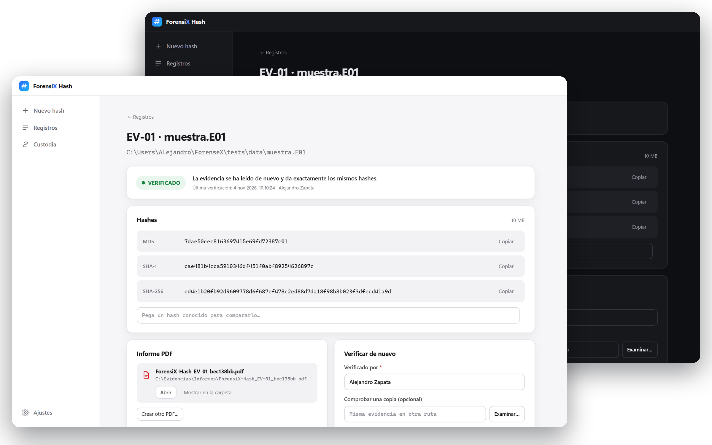
</p>

Herramienta de **hashing forense** de la marca **ForensiX**. Calcula los hashes de un **archivo**, una **carpeta** o un
**disco completo** (pendrives, volúmenes e imágenes `.dd`/`.raw`/`.iso`/`.E01`), crea la **imagen forense**, los
**verifica** con una segunda lectura y guarda un **informe PDF firmado** con quién lo hizo, cuándo se calculó y cuándo
se verificó, con **sello de tiempo** de una autoridad externa.

**Instalar:** descarga `ForensiX-Hash_x.y.z_x64-setup.exe` de la [última versión](https://github.com/ZaperMaster/ForensiX-Hash/releases/latest) y ábrelo. Se instala
para tu usuario **sin pedir administrador**, con acceso en el menú Inicio y en el escritorio, y se desinstala desde
*Aplicaciones instaladas* (tus registros e informes se conservan). Después, la app **se actualiza sola**. Si prefieres
no instalar nada, la Release incluye también `ForensiX-Hash.exe` portable. Ambos se comprueban con `SHA256SUMS.txt`, firmado.

## Cómo se usa

Un asistente de cuatro pasos y el proceso:

| 1 · Evidencia | 2 · Datos |
|---|---|
| 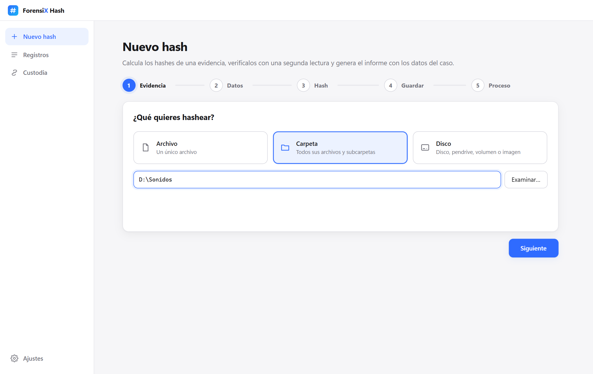 | 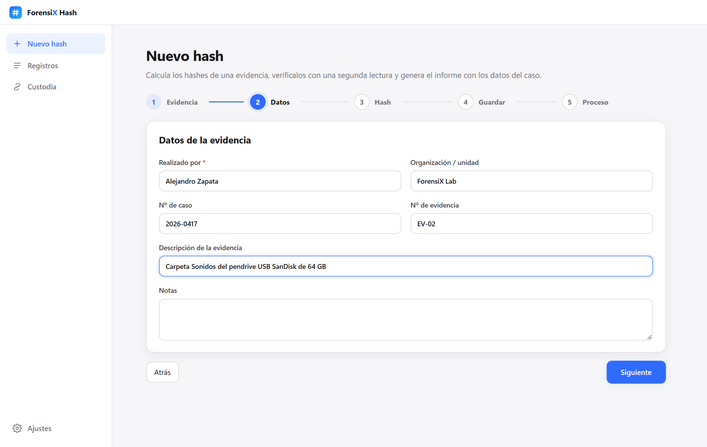 |
| **Archivo, carpeta o disco** (con modelo, nº de serie y conexión) o una imagen de disco. | **Quién lo realiza**, organización, nº de caso, nº de evidencia, descripción y notas. |

| 3 · Hash | 4 · Guardar |
|---|---|
| 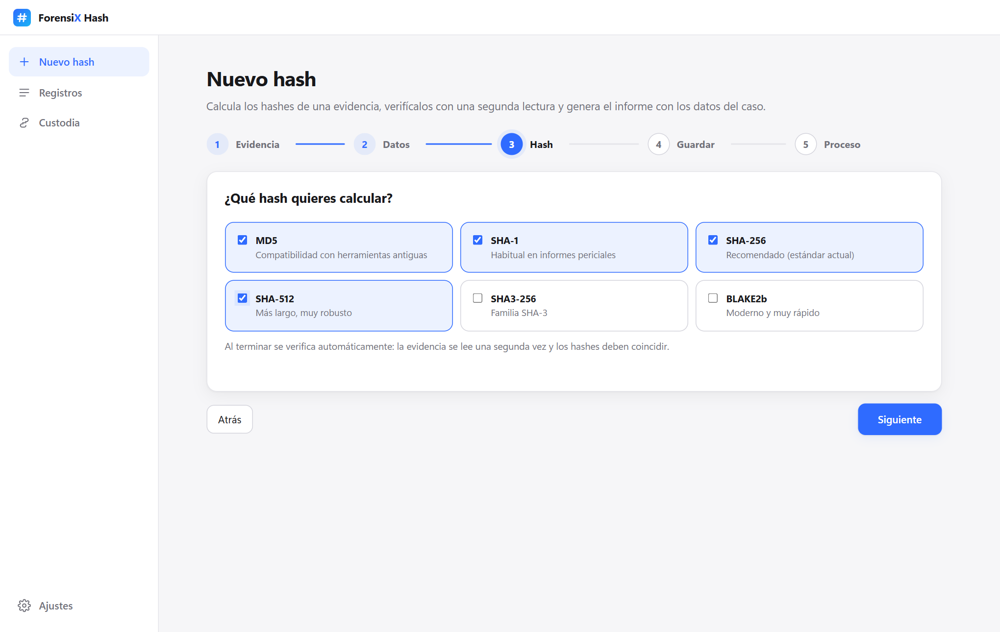 | 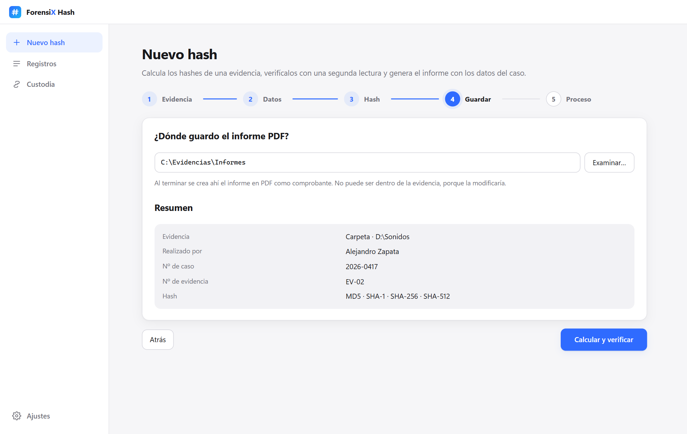 |
| **MD5, SHA-1 y SHA-256** por defecto; también SHA-512, SHA3-256 y BLAKE2b. | **Carpeta del informe PDF** (nunca dentro de la evidencia) y resumen antes de empezar. |

**5 · Proceso**: cálculo, **verificación automática** con una segunda lectura y el **informe PDF** en la carpeta elegida.

<p align="center">
  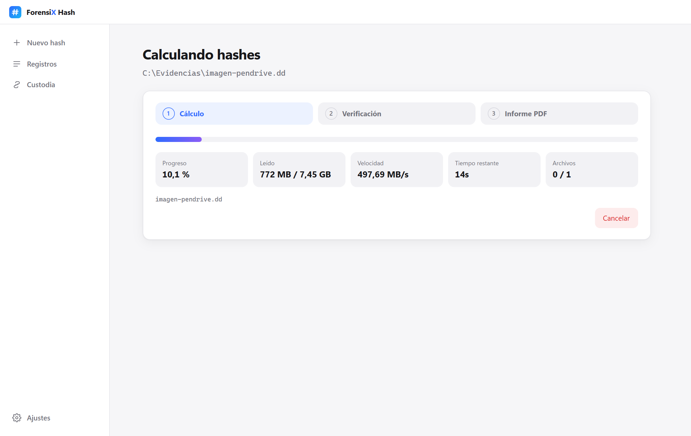
</p>

## Resultado e informe

| Verificado | No coincide |
|---|---|
| 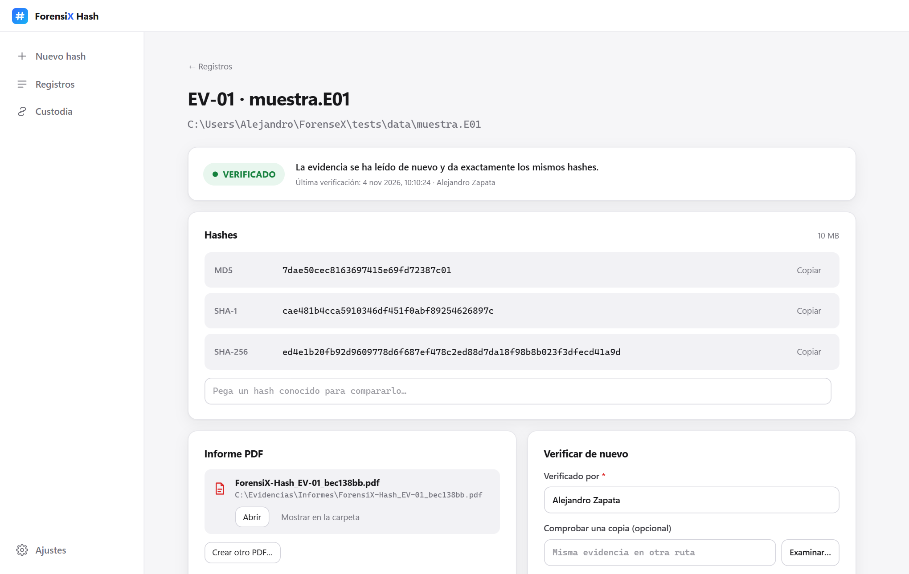 | 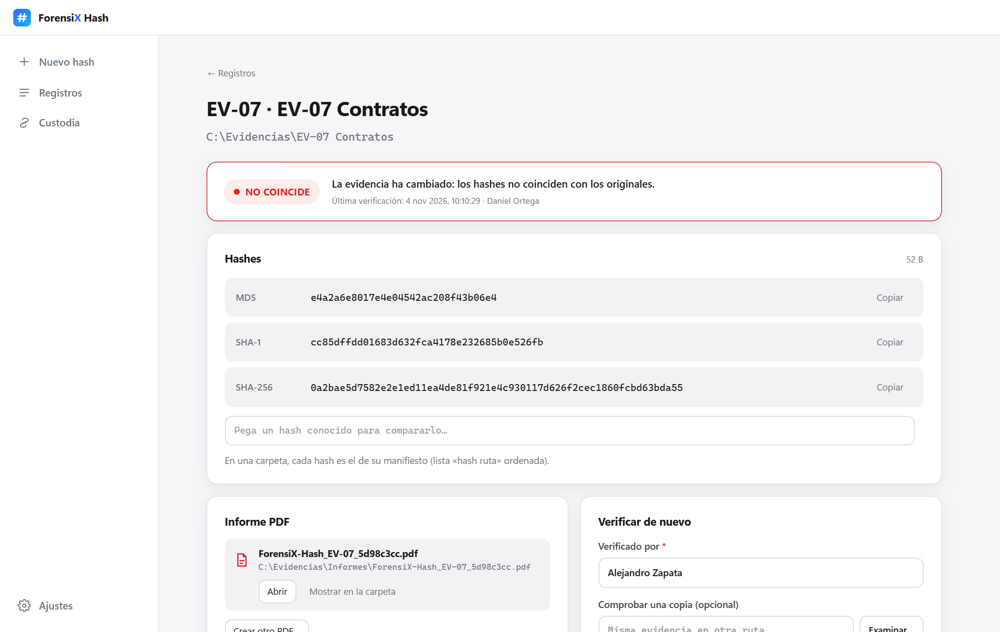 |
| Se vuelve a leer la evidencia y da **los mismos hashes**. | Si la evidencia cambia, la verificación lo detecta y dice **quién y cuándo** la comprobó. |

<p align="center">
  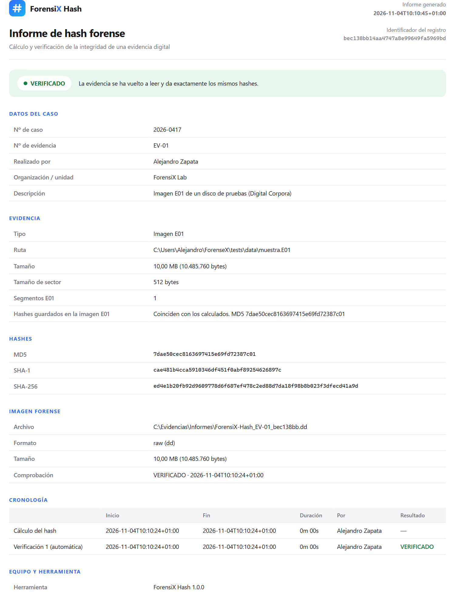<br>
  <sub>El informe PDF: resultado, datos del caso, evidencia, hashes, cronología, cadena de custodia y firmas.</sub>
</p>

## Registros, custodia y temas

| Registros | Cadena de custodia |
|---|---|
| 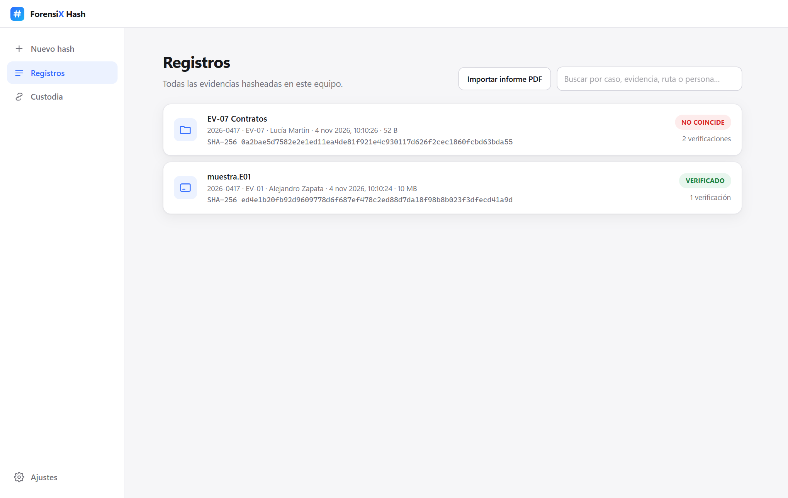 | 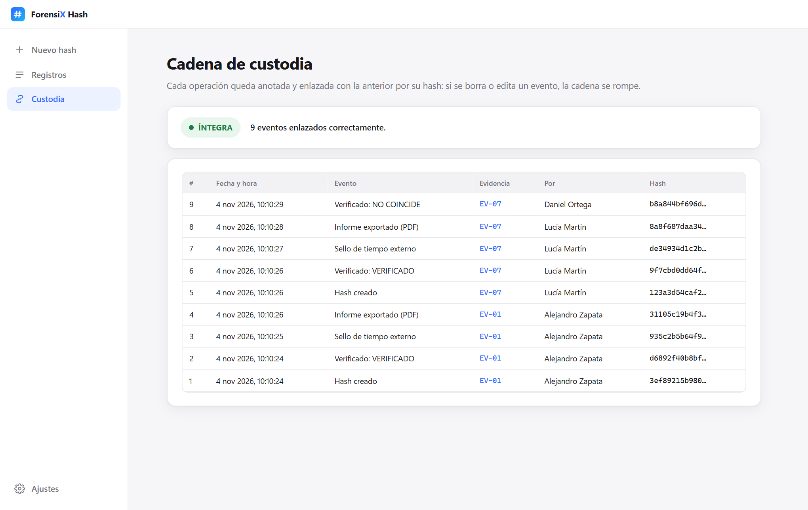 |

| Discos del equipo | Tema oscuro y ajustes |
|---|---|
| 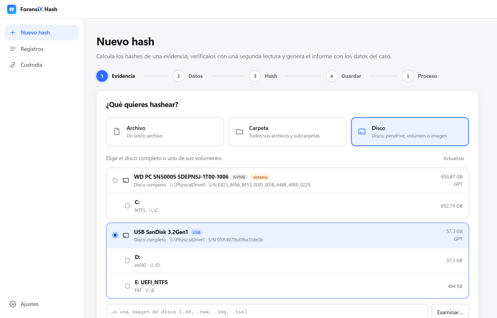 | 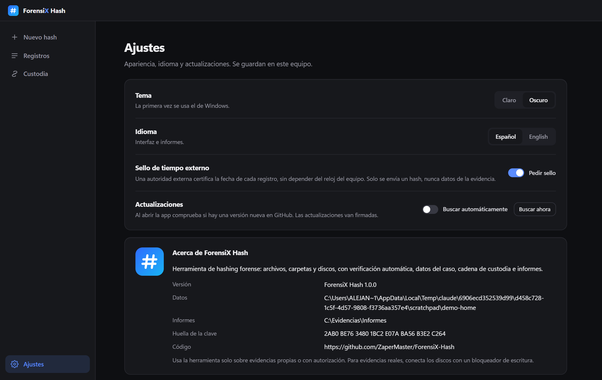 |

<sub>Capturas con la imagen E01 pública `nps-2010-emails` de Digital Corpora y datos de demostración.</sub>

## Qué incluye

**Tres tipos de evidencia**
- **Archivo**: hashes, tamaño y marcas de tiempo (creado, modificado, último acceso). Avisa si cambia mientras se lee.
- **Carpeta**: hash de cada archivo y de la carpeta entera ([cómo se calcula](#hash-de-una-carpeta)), sin
  seguir enlaces. Anota los archivos que no se pueden leer y, al verificar, los **añadidos, eliminados y modificados**.
- **Disco**: el disco físico entero (`\\.\PhysicalDriveN`), un volumen (`\\.\D:`) o una imagen `.dd`/`.raw`/`.iso`, sector a
  sector y en **solo lectura**. Indica si el disco está **protegido contra escritura** y avisa si es el disco del sistema
  (Windows escribe en él mientras se lee). Los sectores ilegibles se leen como ceros y se anotan, como en las
  herramientas de adquisición.
- **Imagen E01** (EnCase): hashea el contenido del disco, no los archivos `.E01`, y lo compara con los hashes que la propia
  imagen lleva guardados.

**Imagen forense**
- Crea una copia `.dd` del disco **durante la primera lectura**, con exactamente los datos que se hashean, y después la
  lee para comprobar que da los mismos hashes. Comprueba antes el espacio libre y que no se guarda en el disco de origen.

**Hashes verificados**
- Todos los algoritmos se calculan **a la vez en una sola lectura**, en paralelo.
- Resultado **VERIFICADO** o **NO COINCIDE**, y **comparar** con un hash conocido pegándolo.

**Informe PDF como comprobante**
- Resultado, datos del caso, evidencia, hashes, cronología (cálculo y cada verificación, con quién, cuándo y en qué
  equipo), cadena de custodia, sello del registro y espacio para **firmas**. En español o inglés.
- Se crea solo al terminar; desde el registro se abre, se muestra en la carpeta o se crea otra copia.
- **Lleva dentro el registro firmado**: se importa en otro equipo para verificar allí la evidencia. Si alguien lo ha
  modificado, no se importa.

**Firma, sello de tiempo y custodia**
- Cada registro lleva un **sello** (SHA-256) y una **firma digital Ed25519** con una clave propia del usuario, protegida
  por Windows (DPAPI). La huella de la clave sale en el informe; si otra persona verifica después, sigue constando quién lo creó.
- **Sello de tiempo RFC 3161** de una autoridad externa (DigiCert, con FreeTSA como alternativa): certifica la fecha sin
  depender del reloj del equipo. Solo se envía un hash, nunca datos de la evidencia, y se puede desactivar.
- **Cadena de custodia**: cada operación incluye el hash del evento anterior y un ancla guarda el último, así que se
  detecta tanto editar o borrar un evento como recortar los últimos.

**Ajustes**
- **Tema** claro u oscuro (la primera vez, el de Windows) e **idioma** español o inglés.
- **Actualizaciones automáticas firmadas**: al abrir, la app mira si hay una versión nueva en GitHub; se instala con un
  clic solo si la **firma Ed25519** y el SHA-256 del `.exe` son correctos. Se puede desactivar.
- La app de escritorio se abre a **pantalla completa**.

## Tres formas de usarlo

Comparten el mismo motor (`forensix_hash/`):

| | Qué es | Dónde está | Cómo se arranca |
|---|---|---|---|
| **App de escritorio** | Programa de Windows con instalador | [`desktop/`](desktop/) | `python -m desktop`, el instalador o el `.exe` |
| **Web** | Servidor local + interfaz en el navegador | [`web/`](web/) | `python -m web` → http://127.0.0.1:8000 |
| **Línea de comandos** | Para scripts y automatización | [`forensix_hash/cli.py`](forensix_hash/cli.py) | `python -m forensix_hash` |

```bash
python -m forensix_hash file  informe.docx --examiner "Ana Pérez" --case 2026-0001 --pdf C:\Informes
python -m forensix_hash dir   C:\Evidencias\EV-02 --examiner "Ana Pérez" --pdf C:\Informes --out ev02.sha256
python -m forensix_hash disks
python -m forensix_hash disk  \\.\PhysicalDrive1 --examiner "Ana Pérez" --evidence EV-01 --pdf D:\Caso --image D:\Caso --timestamp
python -m forensix_hash disk  imagen.E01 --examiner "Ana Pérez" --pdf C:\Informes
python -m forensix_hash verify <id-del-registro> --examiner "Luis Gómez"
python -m forensix_hash import informe.pdf
python -m forensix_hash custody
```

> Leer un **disco completo** necesita permisos de **administrador**. La app avisa y ofrece reiniciarse como
> administrador. Para evidencias reales, conecta el disco con un **bloqueador de escritura**.

## Hash de una carpeta

El hash de una carpeta es el **hash de su manifiesto**: el texto con una línea `hash  ruta` por archivo, ordenado
por ruta (rutas relativas con `/` y Unicode normalizado). Así no depende de dónde esté la carpeta ni del sistema
operativo, y cambia si se modifica, añade, elimina **o renombra** un archivo. El manifiesto se exporta con la línea
de comandos y se comprueba con cualquier herramienta:

```bash
python -m forensix_hash dir carpeta --examiner "Ana Pérez" --out manifiesto.sha256
cd carpeta && sha256sum -c ../manifiesto.sha256    # cada archivo
sha256sum ../manifiesto.sha256                    # = hash SHA-256 de la carpeta en el informe
```

## Dónde se guardan los datos

- **Informes PDF**: en la carpeta que elijas (por defecto `Documentos\ForensiX Hash`).
- **Registros y custodia**: `%LOCALAPPDATA%\ForensiX Hash\` (Windows) o `~/.local/share/forensix-hash/` (Linux), con
  `records/` (un JSON sellado por evidencia) y `custody.jsonl`. Se puede cambiar con `FORENSIX_HASH_HOME`.

Las evidencias, los registros y los informes no salen del equipo. Solo hay dos conexiones, y las dos se pueden
desactivar en **Ajustes**: buscar actualizaciones en GitHub y pedir el sello de tiempo, que envía únicamente un hash.

## Cómo se ha comprobado

Además de las pruebas automáticas (Windows y Linux, Python 3.13 y 3.15):

- **Hashes** contra `Get-FileHash` de Windows y una lectura independiente de un volumen en bruto.
- **Disco real:** pendrive USB de 64 GB leído dos veces y carpeta de 8.693 archivos.
- **E01 real:** imagen `nps-2010-emails` de [Digital Corpora](https://digitalcorpora.org/), creada en 2011 por otra
  herramienta: el MD5 calculado y el del `.dd` creado coinciden con el guardado en la imagen.
- **Sello de tiempo** real de DigiCert, leído con `openssl ts`.
- **Actualización real:** una versión 0.9.9 se actualiza sola a la publicada, comprobando la firma.
- **Sin administrador:** con un token restringido se rechaza leer el disco y todo lo demás funciona.

## Desarrollo

```bash
py -3 -m venv .venv
.venv\Scripts\python.exe -m pip install -r desktop\requirements.txt
.venv\Scripts\python.exe -m pytest           # pruebas automáticas
.venv\Scripts\python.exe -m web               # versión web
.venv\Scripts\python.exe -m desktop           # app de escritorio
desktop\build_windows.bat                     # dist\: .exe, instalador y SHA256SUMS.txt
```

El PDF se genera con **Microsoft Edge** (incluido en Windows) en modo sin ventana; en Linux sirve Chrome o Chromium.
La página web del proyecto está en `docs/` (GitHub Pages desde la carpeta `/docs`).

### Publicar una versión

1. Sube la versión en `forensix_hash/__init__.py` y `desktop/version_info.txt`, y escribe las novedades en
   [CHANGELOG.md](CHANGELOG.md).
2. `desktop\build_windows.bat` y después:

```bash
python scripts/release.py --notes notas.md     # firma SHA256SUMS.txt y crea la Release vX.Y.Z
python scripts/release.py --replace            # o sustituye los archivos de la Release de la misma versión
```

El script firma `SHA256SUMS.txt` con la clave privada de `%USERPROFILE%\.forensix\update-ed25519.pem`
(`python scripts/release.py --init-key` la crea la primera vez). **No la subas nunca al repositorio y guarda una copia
de seguridad**: sin ella, las apps instaladas no aceptarán actualizaciones. La clave pública está en
`forensix_hash/updater.py`.

### Estructura

```
forensix_hash/            Motor (compartido por la app, la web y la línea de comandos)
  hasher.py               Varios algoritmos a la vez, en paralelo, en una sola lectura
  sources.py              Archivo, carpeta (manifiesto) y disco sector a sector
  devices.py              Discos y volúmenes del equipo, tamaño real y permisos
  engine.py               Cálculo + verificación automática y verificaciones posteriores
  record.py / store.py    Registro sellado y cadena de custodia
  report.py / pdf.py      Informe (HTML → PDF con Edge), registro adjunto y destino seguro
  signing.py              Firma Ed25519 y sello de tiempo RFC 3161
  paths.py                Solo rutas de unidades locales
  updater.py              Actualizaciones firmadas (Ed25519)
  jobs.py / progress.py   Operaciones en segundo plano con progreso y cancelación
  cli.py                  Línea de comandos
web/                      Versión web       → ver web/README.md
  server.py               API local (FastAPI), solo en 127.0.0.1
  static/                 Interfaz: asistente, registros, custodia y ajustes (temas claro y oscuro)
desktop/                  App de escritorio → ver desktop/README.md
scripts/                  Publicar versiones, avisos de terceros y capturas
docs/                     Página web del proyecto (GitHub Pages)
tests/                    Pruebas del motor, el PDF, las actualizaciones, la línea de comandos y la API
```

## Seguridad

- La evidencia se abre **solo en modo lectura**, y el PDF no se puede guardar dentro de ella.
- La API web solo escucha en `127.0.0.1`, comprueba que el `Host` sea local (contra *DNS rebinding*) y exige una
  cabecera propia en cada petición (una web ajena no puede llamarla).
- Solo acepta rutas de **unidades locales**: abrir una ruta de red (`\\servidor\recurso`) entregaría el hash NTLM del
  usuario a ese servidor.
- Las **actualizaciones van firmadas**: nada se instala sin una firma Ed25519 válida.
- El código se revisa con **CodeQL**, las dependencias con **Dependabot** y el repositorio tiene **escaneo de
  secretos** con protección al subir. Ver [SECURITY.md](SECURITY.md).

> **Límites honestos:** quien controle la cuenta del usuario podría firmar con su clave, aunque no conseguir un sello de
> tiempo con fecha anterior. La firma identifica una clave, no a una persona: anota la huella en tu procedimiento. Y el
> código no es un producto certificado: valídalo según tu laboratorio antes de usarlo en un caso real.

## Licencia

**Código abierto** con licencia [MIT](LICENSE) © 2026 Alejandro Zapata: puedes usarla, estudiarla, modificarla y
redistribuirla libremente, también con fines comerciales, conservando el aviso de copyright. Se ofrece sin garantía.
Las contribuciones son bienvenidas: mira [CONTRIBUTING.md](CONTRIBUTING.md).

Las librerías de terceros incluidas en el `.exe` y sus licencias están en
[THIRD_PARTY_NOTICES.md](THIRD_PARTY_NOTICES.md).

## Autor

Hecho por [ZaperMaster](https://github.com/ZaperMaster) · parte de **ForensiX**.
