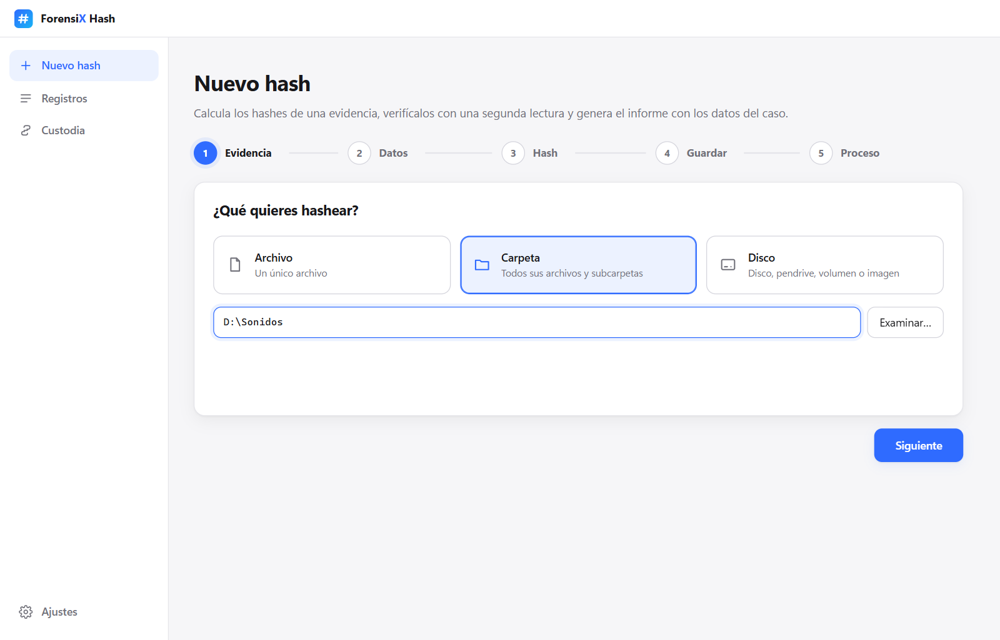
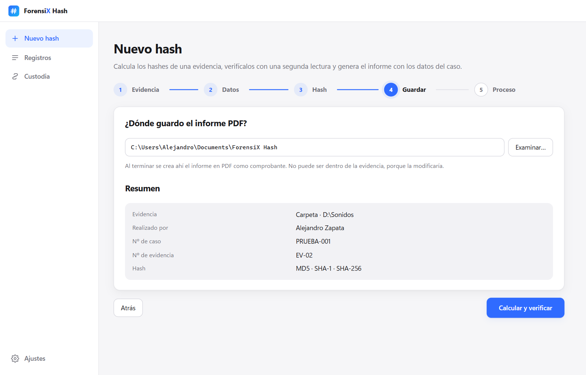

# ForensiX Hash

[](https://github.com/ZaperMaster/ForensiX-Hash/actions/workflows/tests.yml)
[](https://github.com/ZaperMaster/ForensiX-Hash/security/code-scanning)
[](https://github.com/ZaperMaster/ForensiX-Hash/releases/latest)


[](LICENSE)
[](https://zapermaster.github.io/ForensiX-Hash/)

Herramienta de **hashing forense** de la marca **ForensiX**: calcula los hashes de un **archivo**, una
**carpeta** o un **disco completo** (también pendrives, volúmenes e imágenes `.dd`/`.raw`/`.iso`), los
**verifica automáticamente** con una segunda lectura y guarda un **informe PDF** como comprobante, con quién
lo hizo, cuándo se calculó y cuándo se verificó.

**Descargar:** [última versión](https://github.com/ZaperMaster/ForensiX-Hash/releases/latest) →
`ForensiX-Hash.exe` (con `SHA256SUMS.txt` para comprobar la descarga). Una vez abierta, la app **se actualiza
sola**. Novedades: [CHANGELOG.md](CHANGELOG.md). Web del proyecto:
**[zapermaster.github.io/ForensiX-Hash](https://zapermaster.github.io/ForensiX-Hash/)**.

## Capturas

<p align="center">
  
</p>

| 1 · Evidencia | 4 · Guardar el informe |
|---|---|
|  |  |

| Proceso | Informe PDF |
|---|---|
|  |  |

| Discos | Tema oscuro y ajustes |
|---|---|
|  |  |

<sub>Pruebas con un pendrive USB SanDisk de 64 GB del propio autor.</sub>

## Cómo se usa

Un asistente de cuatro pasos y el proceso:

1. **Evidencia** — archivo, carpeta o disco (con modelo, número de serie y conexión) o imagen de disco.
2. **Datos** — quién lo realiza, organización, nº de caso, nº de evidencia, descripción y notas.
3. **Hash** — MD5, SHA-1 y SHA-256 por defecto; también SHA-512, SHA3-256 y BLAKE2b.
4. **Guardar** — la carpeta del informe PDF (no puede estar dentro de la evidencia: la modificaría).
5. **Proceso** — cálculo, **verificación automática** con una segunda lectura y el **informe PDF** en la carpeta
   elegida.

Después, desde **Registros**, se puede volver a verificar cuando se quiera (otra persona, otro día, o una
**copia** en otra ruta), y cada verificación genera su propio PDF.

## Qué incluye

**Tres tipos de evidencia**
- **Archivo**: hashes, tamaño y marcas de tiempo (creado, modificado, último acceso). Avisa si cambia mientras se lee.
- **Carpeta**: hash de cada archivo y de la carpeta entera ([cómo se calcula](#hash-de-una-carpeta)), sin
  seguir enlaces. Anota los archivos que no se pueden leer y, al verificar, los **añadidos, eliminados y modificados**.
- **Disco**: el disco físico entero (`\\.\PhysicalDriveN`), un volumen (`\\.\D:`) o una imagen, sector a sector y en
  **solo lectura**. Los sectores ilegibles se leen como ceros y se anotan, como en las herramientas de adquisición.

**Hashes verificados**
- Todos los algoritmos se calculan **a la vez en una sola lectura**, en paralelo.
- Resultado **VERIFICADO** o **NO COINCIDE**, y **comparar** con un hash conocido pegándolo.

**Informe PDF como comprobante**
- Resultado, datos del caso, evidencia, hashes, cronología (cálculo y cada verificación, con quién, cuándo y en qué
  equipo), cadena de custodia, sello del registro y espacio para **firmas**. En español o inglés.
- Se crea solo al terminar; desde el registro se abre, se muestra en la carpeta o se crea otra copia.

**Integridad y cadena de custodia**
- Cada registro lleva un **sello** (SHA-256 del registro): si alguien lo edita, la app lo marca como **MODIFICADO**.
- **Cadena de custodia**: cada operación (hash creado, verificado, PDF creado) incluye el hash del evento anterior; si
  se borra o edita uno, la cadena se rompe y se ve en qué punto.

**Ajustes**
- **Tema** claro u oscuro (la primera vez, el de Windows) e **idioma** español o inglés.
- **Actualizaciones automáticas firmadas**: al abrir, la app mira si hay una versión nueva en GitHub; se instala con un
  clic solo si la **firma Ed25519** y el SHA-256 del `.exe` son correctos. Se puede desactivar.
- La app de escritorio se abre a **pantalla completa**.

## Tres formas de usarlo

Comparten el mismo motor (`forensix_hash/`):

| | Qué es | Dónde está | Cómo se arranca |
|---|---|---|---|
| **App de escritorio** | Programa de Windows (`ForensiX-Hash.exe`) | [`desktop/`](desktop/) | `python -m desktop` o el `.exe` |
| **Web** | Servidor local + interfaz en el navegador | [`web/`](web/) | `python -m web` → http://127.0.0.1:8000 |
| **Línea de comandos** | Para scripts y automatización | [`forensix_hash/cli.py`](forensix_hash/cli.py) | `python -m forensix_hash` |

```bash
python -m forensix_hash file  informe.docx --examiner "Ana Pérez" --case 2026-0001 --pdf C:\Informes
python -m forensix_hash dir   C:\Evidencias\EV-02 --examiner "Ana Pérez" --pdf C:\Informes --out ev02.sha256
python -m forensix_hash disks
python -m forensix_hash disk  \\.\PhysicalDrive1 --examiner "Ana Pérez" --evidence EV-01 --pdf C:\Informes
python -m forensix_hash verify <id-del-registro> --examiner "Luis Gómez"
python -m forensix_hash custody
```

> Leer un **disco completo** necesita permisos de **administrador**. La app avisa y ofrece reiniciarse como
> administrador. Para evidencias reales, conecta el disco con un **bloqueador de escritura**.

## Hash de una carpeta

El hash de una carpeta es el **hash de su manifiesto**: el texto con una línea `hash  ruta` por archivo, ordenado
por ruta (rutas relativas con `/` y Unicode normalizado). Así no depende de dónde esté la carpeta ni del sistema
operativo, y cambia si se modifica, añade, elimina **o renombra** un archivo. El manifiesto se exporta con la línea
de comandos y se comprueba con cualquier herramienta:

```bash
python -m forensix_hash dir carpeta --examiner "Ana Pérez" --out manifiesto.sha256
cd carpeta && sha256sum -c ../manifiesto.sha256    # cada archivo
sha256sum ../manifiesto.sha256                    # = hash SHA-256 de la carpeta en el informe
```

## Dónde se guardan los datos

- **Informes PDF**: en la carpeta que elijas (por defecto `Documentos\ForensiX Hash`).
- **Registros y custodia**: `%LOCALAPPDATA%\ForensiX Hash\` (Windows) o `~/.local/share/forensix-hash/` (Linux), con
  `records/` (un JSON sellado por evidencia) y `custody.jsonl`. Se puede cambiar con `FORENSIX_HASH_HOME`.

Las evidencias, los registros y los informes no salen del equipo. La única conexión es la consulta a GitHub para
buscar actualizaciones, que se puede desactivar en **Ajustes**.

## Desarrollo

```bash
py -3 -m venv .venv
.venv\Scripts\python.exe -m pip install -r desktop\requirements.txt
.venv\Scripts\python.exe -m pytest           # pruebas automáticas
.venv\Scripts\python.exe -m web               # versión web
.venv\Scripts\python.exe -m desktop           # app de escritorio
desktop\build_windows.bat                     # dist\ForensiX-Hash.exe + SHA256SUMS.txt
```

El PDF se genera con **Microsoft Edge** (incluido en Windows) en modo sin ventana; en Linux sirve Chrome o Chromium.
La página web del proyecto está en `docs/` (GitHub Pages desde la carpeta `/docs`).

### Publicar una versión

1. Sube la versión en `forensix_hash/__init__.py` y `desktop/version_info.txt`, y escribe las novedades en
   [CHANGELOG.md](CHANGELOG.md).
2. `desktop\build_windows.bat` y después:

```bash
python scripts/release.py --notes notas.md     # firma SHA256SUMS.txt y crea la Release vX.Y.Z
python scripts/release.py --replace            # o sustituye los archivos de la Release de la misma versión
```

El script firma `SHA256SUMS.txt` con la clave privada de `%USERPROFILE%\.forensix\update-ed25519.pem`
(`python scripts/release.py --init-key` la crea la primera vez). **No la subas nunca al repositorio y guarda una copia
de seguridad**: sin ella, las apps instaladas no aceptarán actualizaciones. La clave pública está en
`forensix_hash/updater.py`.

### Estructura

```
forensix_hash/            Motor (compartido por la app, la web y la línea de comandos)
  hasher.py               Varios algoritmos a la vez, en paralelo, en una sola lectura
  sources.py              Archivo, carpeta (manifiesto) y disco sector a sector
  devices.py              Discos y volúmenes del equipo, tamaño real y permisos
  engine.py               Cálculo + verificación automática y verificaciones posteriores
  record.py / store.py    Registro sellado y cadena de custodia
  report.py / pdf.py      Informe (HTML → PDF con Edge) y destino seguro del PDF
  updater.py              Actualizaciones firmadas (Ed25519)
  jobs.py / progress.py   Operaciones en segundo plano con progreso y cancelación
  cli.py                  Línea de comandos
web/                      Versión web       → ver web/README.md
  server.py               API local (FastAPI), solo en 127.0.0.1
  static/                 Interfaz: asistente, registros, custodia y ajustes (temas claro y oscuro)
desktop/                  App de escritorio → ver desktop/README.md
scripts/                  Publicar versiones, avisos de terceros y capturas
docs/                     Página web del proyecto (GitHub Pages)
tests/                    Pruebas del motor, el PDF, las actualizaciones, la línea de comandos y la API
```

## Seguridad

- La evidencia se abre **solo en modo lectura**, y el PDF no se puede guardar dentro de ella.
- La API web solo escucha en `127.0.0.1`, comprueba que el `Host` sea local (contra *DNS rebinding*) y exige una
  cabecera propia en cada petición (una web ajena no puede llamarla).
- Las **actualizaciones van firmadas**: nada se instala sin una firma Ed25519 válida.
- El código se revisa con **CodeQL**, las dependencias con **Dependabot** y el repositorio tiene **escaneo de
  secretos** con protección al subir. Ver [SECURITY.md](SECURITY.md).

> El sello y la cadena de custodia **detectan** cambios en los registros, pero no son una firma digital: quien tenga
> acceso al equipo podría recalcularlos. Guarda el PDF firmado fuera del equipo, como en cualquier custodia.

## Licencia

[PolyForm Strict 1.0.0](LICENSE) © 2026 Alejandro Zapata. Todos los demás derechos reservados.

- **Sí se puede:** descargar y usar ForensiX Hash gratis para cualquier fin no comercial (uso personal, estudio,
  organizaciones sin ánimo de lucro, instituciones públicas…) y leer su código.
- **No se puede:** venderla ni usarla con fines comerciales, ni usar su código (copiarlo, modificarlo o reutilizarlo en
  otros proyectos) ni redistribuirla.

Las librerías de terceros incluidas en el `.exe` y sus licencias están en
[THIRD_PARTY_NOTICES.md](THIRD_PARTY_NOTICES.md).

## Autor

Hecho por [ZaperMaster](https://github.com/ZaperMaster) · parte de **ForensiX**.
